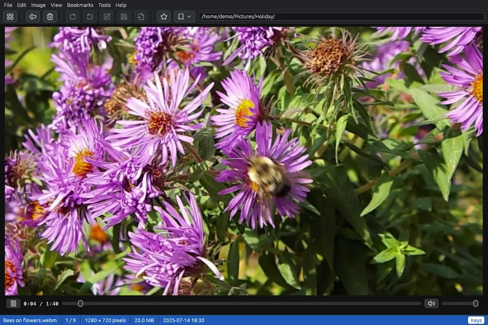

# Riprodurre i video

I video compaiono nella griglia insieme alle foto, con un fotogramma del video come miniatura e il simbolo . Si aprono nel visore, dove partono con l'audio. Lì si ascoltano anche i file audio.

## Guardare un video

Fai doppio clic su un video, oppure selezionalo e premi **Invio**: si apre nel visore, adattato alla finestra, e parte.

- **Spazio**, un clic sul video, oppure  /  sotto il video, avviano e mettono in pausa.
- La barra sotto il video mostra il tempo e il punto in cui sei: trascinala, o fai clic su un punto, per andare lì.
- **Ctrl+←** e **Ctrl+→** vanno indietro e avanti di 5 secondi.
- Alla fine resta l'ultimo fotogramma; facendo ripartire il video, riparte dall'inizio.

## Audio

I comandi dell'audio sono a destra della barra:  toglie l'audio e  lo rimette, e il cursore regola il volume da 0 a 100.

- **↑** e **↓**, o la rotellina del mouse sul video, alzano e abbassano il volume di 5.
- **M** toglie e rimette l'audio.

Volume e audio spento restano per i video successivi e alla prossima apertura di EyeCanSee. Su un video senza audio i due comandi sono grigi.

## Passare da un file all'altro

| Tasto | Cosa fa |
|---|---|
| →, Pag↓ | File successivo |
| ←, Backspace, Pag↑ | File precedente |
| Inizio, Fine | Primo, ultimo file |
| Esc, doppio clic | Torna alla griglia |
| F11 | Schermo intero: solo il video |

**F2** rinomina il video e **Canc** lo elimina, come per le foto. Il pulsante **Tasti** nella barra di stato elenca questi tasti.

## File audio

I file audio (per esempio MP3, M4A, FLAC, Opus) compaiono nella griglia con la loro copertina e il simbolo , oppure con una nota se non hanno copertina. Il visore li riproduce con la stessa barra e lo stesso volume; la copertina si vede come immagine.

## Il motore video

I video li riproduce mpv. Quando EyeCanSee ha bisogno di una copia sua (di solito su Windows; su Linux quando il sistema non ce l'ha, ne ha una troppo vecchia o una che non sa riprodurre H.264 e HEVC, i formati in cui registrano i telefoni), il visore propone di scaricarla la prima volta che apri un video, e in alto a destra nella barra dei menù compare il pulsante rosso **Scarica il motore video** appena la cartella aperta contiene un video o un file audio. Si scarica una volta sola. Vedi [Componenti aggiuntivi](components.md).

Fino ad allora la miniatura di un video è l'anteprima salvata dalla videocamera, quando c'è, oppure il simbolo del video con .

## Da sapere

- I video su un telefono o su un server si leggono un pezzo alla volta mentre scorrono, anche da un telefono su Windows. Solo un telefono che non permette di saltare in mezzo a un file (Windows se ne accorge alla prima lettura lenta) ha i video copiati tutti prima, con una barra che mostra quanto ne è stato letto.
- Ruotare, salvare e modificare nel visore valgono per le foto. Per ruotare, rimpicciolire o convertire un video usa [Convertire i video](convert-video.md).
- Il pannello dei metadati mostra i dati di un video selezionato: vedi [Informazioni sul file](metadata.md).
- Quali formati si riproducono: vedi [Formati supportati](formats.md).
