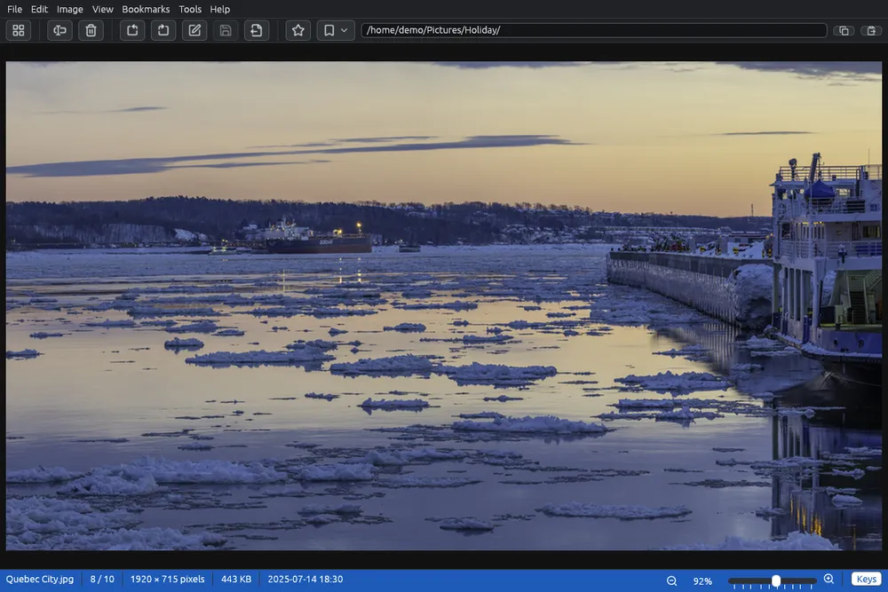
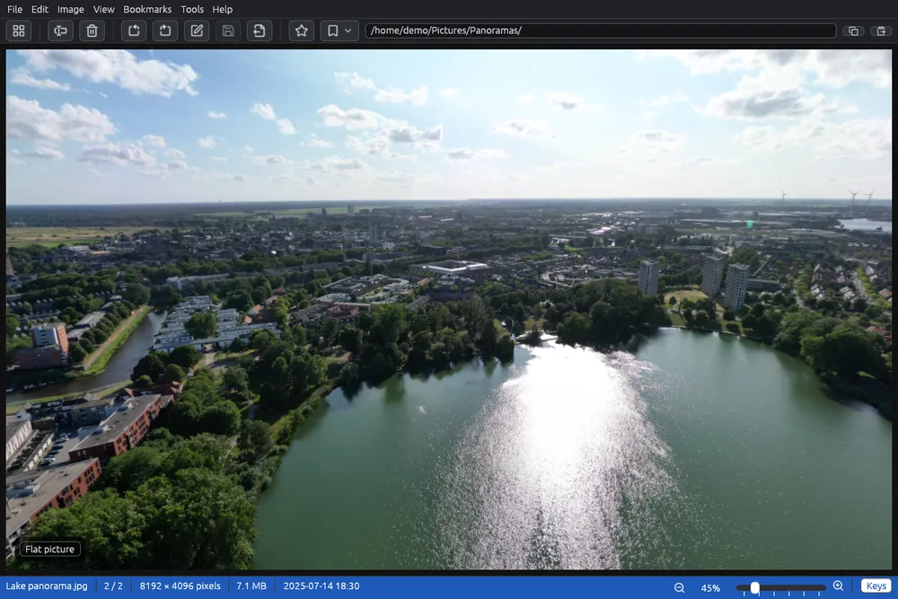

# Guardare le immagini

Il visore mostra una foto alla volta, grande quanto la finestra permette. Da lì passi alla foto successiva, ingrandisci, ruoti la foto e torni alla griglia.

## Aprire e chiudere il visore

- Fai doppio clic su una foto nella griglia, oppure selezionala e premi **Invio** (anche **Visualizza > Apri**).
- Per tornare alla griglia: **Esc**, un doppio clic sulla foto (se nelle [Opzioni](options.md) non è impostato per andare a schermo intero),  **Torna alla griglia** nella barra strumenti, oppure **Visualizza > Torna alla griglia**. Nella griglia resta selezionata la foto che stavi guardando.
- Anche la ✕ della finestra torna alla griglia invece di chiudere EyeCanSee. Si può cambiare nelle [Opzioni](options.md).

Con più file selezionati, Invio apre il primo, e il visore si muove solo tra quelli.

## Passare da una foto all'altra

| Tasto | Cosa fa |
|---|---|
| →, Spazio, Pag↓ | Foto successiva |
| ←, Backspace, Pag↑ | Foto precedente |
| Inizio, Fine | Prima, ultima foto |

Le stesse voci sono nel menù **Visualizza** (Avanti, Indietro, Primo, Ultimo). Dopo l'ultima foto il visore si ferma; nelle [Opzioni](options.md) puoi farlo ricominciare dalla prima. Le foto vicine a quella mostrata vengono lette in anticipo, così si passa dall'una all'altra in fretta anche su un telefono o su un server.

## Immagini molto grandi

Un'immagine più grande di 8192 pixel sul lato lungo viene mostrata ridotta a 8192 pixel; un JPEG viene letto già ridotto, così occupa meno memoria. Un'immagine che per aprirsi chiederebbe più di metà della memoria del computer (per esempio un HEIC, un TIFF a 16 bit, un file di Photoshop o un JPEG XL di centinaia di megapixel, su un computer da 8 GB) non si apre subito: al suo posto il visore dice quanta memoria le serve e propone **Apri comunque**. Se la apri comunque, il computer può rallentare molto, oppure il sistema può chiudere EyeCanSee. Dopo averla aperta comunque, quell'immagine si apre senza domande (anche nell'editor, in Salva come, Converti, Ridimensiona e salvando una rotazione) finché EyeCanSee resta aperto; quando EyeCanSee riparte, il visore lo chiede di nuovo. Le frecce passano all'immagine dopo come sempre; un'immagine non aperta resta chiusa, e il visore lo dice di nuovo quando ci torni. Un'immagine così grande non viene mai preparata in anticipo come vicina, nemmeno dopo averla aperta comunque: il suo file si legge tutto in una volta quando non supera i 32 MB, e di uno più grande solo l'inizio, quando lì ci sono le dimensioni dell'immagine (un TIFF le ha spesso in fondo, e viene letto tutto), e non viene aperta; il carosello non la mostra, a meno che sia stata aperta comunque: allora si apre quando tocca a lei. Nella griglia non ha la miniatura (vedi [La griglia delle miniature](grid.md)).

## Animazioni e pagine

Le immagini animate GIF, WebP e PNG (APNG) si muovono nel visore, ripetendosi. **Spazio** le mette in pausa e le fa ripartire, come il pulsante nella piccola barra in fondo all'immagine, che mostra anche il fotogramma (per esempio Fotogramma 3 / 20, anche nella barra di stato). L'animazione si ferma quando passi a un'altra immagine e riparte dal primo fotogramma quando torni. Un'animazione molto lunga o molto grande (più di 256 MB una volta decodificata) non viene riprodotta: il visore mostra il primo fotogramma e dice perché.

Un TIFF con più pagine (un documento scansionato, un fax) si apre sulla prima pagina. **Pag↓** e **Pag↑** sfogliano le pagine, come le frecce nella barra in fondo, che mostra la pagina (per esempio Pagina 2 / 5, anche nella barra di stato); dopo l'ultima pagina Pag↓ passa al file successivo, e prima della prima Pag↑ al precedente. Ogni pagina viene adattata alla finestra.

## Foto in movimento

Una foto in movimento (Google Pixel, Samsung, Xiaomi e altri telefoni) contiene un breve video registrato insieme alla foto. Il visore mostra la foto con un pulsante **Riproduci il movimento** in fondo; il pulsante o **Spazio** riproducono il video una volta, con la barra di un [video](video.md), poi torna la foto. Il video ha bisogno del motore video, come tutti i video.

## Panorami a 360°

Un panorama a 360° (da un drone, da un telefono o da una fotocamera a 360°) è una foto di tutto ciò che sta intorno alla fotocamera, srotolata in un'immagine larga il doppio di quanto è alta. Quando il file lo dice (i tag Google Photo Sphere nei suoi metadati, che scrive la maggior parte delle fotocamere e delle app), il visore lo mostra da dentro, come se fossi nel punto in cui è stato scattato:

- Trascina per guardarti intorno. La **rotellina**, **+** e **−** ingrandiscono e rimpiccioliscono (la rotellina come impostato nelle [Opzioni](options.md), e sempre con **Ctrl**); **0** torna alla vista di partenza, **1** mostra il centro al 100%. La percentuale nella barra di stato è quella del centro della vista.
- Un panorama parziale (che non fa tutto il giro, o non arriva in alto e in basso) mostra solo ciò che copre, e la vista si ferma ai suoi bordi.
- **P**, o **Foto piatta** in basso a sinistra, mostra la foto piatta, come ogni altra; **P** o **Vista a 360°** la mostra di nuovo come una sfera. La scelta vale per i panorami che apri dopo, finché EyeCanSee resta aperto.
- Ruotato o riflesso e non ancora salvato (vedi [Ruotare e riflettere](rotate.md)), o mentre misuri, un panorama si vede piatto. Le miniature, il carosello, il salvataggio, la copia e l'editor usano sempre la foto piatta.
- Salvato capovolto o girato di lato, ribaltato dall'alto in basso, o ritagliato, un panorama non lo è più: EyeCanSee toglie i suoi tag Photo Sphere, e il resto dei metadati resta. Rimpicciolito o ingrandito, o ribaltato da sinistra a destra, resta un panorama.

Un panorama più grande di 8192 pixel si vede ridotto a 8192 (vedi Immagini molto grandi qui sopra): ingrandendo molto non si vedono altri dettagli.

## Ingrandire

- La **rotellina del mouse** ingrandisce e rimpicciolisce attorno al puntatore; **+** e **−** attorno al centro della finestra. Sul touchpad, avvicina o allontana due dita.
- **0** adatta di nuovo la foto alla finestra; **1** la mostra al 100%, un pixel della foto per ogni pixel dello schermo. Le percentuali contano i pixel del file, anche per una foto molto grande mostrata ridotta e per un disegno SVG (alla grandezza che dichiara).
- A destra nella barra di stato, accanto a **Tasti**:  e  fanno come **−** e **+**; fai clic sulla percentuale e scrivine un'altra (per esempio **37** e **Invio**; **Esc** la lascia com'era), oppure trascina il cursore accanto: le sue tacche stanno su zoom tondi (10%, 25%, 50%, 100%, 200%…), e più è a sinistra, più la foto è piccola.
- Trascina una foto ingrandita per spostarla.
- Sotto il 100% ogni punto dello schermo mostra la media dei pixel che copre, a ogni zoom: i bordi restano lisci e i dettagli fini (erba, capelli) non diventano granulosi. Si può spegnere nelle [Opzioni](options.md) > Aspetto.

Una foto si apre adattata alla finestra, e una foto piccola alla sua grandezza vera, senza ingrandirla. Puoi rimpicciolirla sotto la misura adattata, fino all'1% (un panorama lungo si ferma quando il lato corto è di 16 pixel sullo schermo): rimpicciolendo, la rotellina e **−** si fermano una volta sulla misura adattata, poi proseguono; più piccola della finestra, la foto resta al centro. Un disegno SVG si ingrandisce fino a riempire la finestra, anche quando è più piccolo. Un disegno CAD non si vede mai più piccolo della misura adattata alla finestra. L'ingrandimento massimo (2000% all'inizio) si regola nelle [Opzioni](options.md); per un disegno SVG più piccolo di 2048 pixel si conta sui 2048 pixel a cui viene disegnato, quindi la sua percentuale può salire molto di più. Nelle Opzioni puoi anche far cambiare foto alla rotellina invece di ingrandire: allora **Ctrl** e la rotellina ingrandiscono comunque. La foto successiva parte di nuovo adattata.

## La barra di stato del visore

In fondo: il nome del file, la sua posizione nella cartella (per esempio 12 / 51), le dimensioni in pixel (le sue, come nel pannello dei metadati, anche quando è mostrata ridotta, e per un disegno SVG quelle che dichiara), il peso su disco e la sua data: quella dello scatto se i metadati sono già stati letti nella griglia, altrimenti quella di modifica del file. Dopo una rotazione non ancora salvata dice anche **Modificata, non salvata**. A destra, su una foto, lo zoom con i suoi pulsanti e il cursore (vedi Ingrandire, sopra).

Il pulsante **Tasti** a destra elenca i tasti di ciò che stai guardando (una foto, un video, un modello 3D o un disegno CAD): finché il mouse ci sta sopra, o finché non ci fai clic di nuovo.

## La barra strumenti nel visore

La barra strumenti tiene solo ciò che lavora sulla foto mostrata:  **Rinomina…**,  **Elimina…**,  e  per ruotarla,  **Modifica immagine…**,  **Salva** e  **Salva come…**, poi i segnalibri e la barra degli indirizzi. Nuova cartella, taglia, copia, incolla e gli strumenti sono per la griglia; restano nei menù. Su un video o un file audio i pulsanti per le immagini restano al loro posto, grigi: passando col mouse su uno compare il motivo.

## Schermo intero

**F11**, oppure **Visualizza > Schermo intero**, mostra la foto da sola, senza menù né barre, su fondo nero. Il menù del clic destro ha la stessa voce; a schermo intero diventa **Esci dallo schermo intero**. **Esc** prima esce dallo schermo intero, poi torna alla griglia.

Con **Doppio clic nel visore** impostato su **Va a schermo intero** nelle [Opzioni](options.md), un doppio clic su una foto, un video, un modello o un disegno va a schermo intero, e un altro doppio clic torna alla finestra. Mentre misuri, il doppio clic serve alla misura.

Un video a schermo intero riempie lo schermo: la sua barra compare sopra la parte bassa dell'immagine quando si muove il mouse e sparisce col puntatore dopo 2 secondi di mouse fermo (resta finché il puntatore è sopra).

## Cos'altro puoi fare

- Ruotare e riflettere la foto: vedi [Ruotare e riflettere](rotate.md).
- Disegnarci sopra, ritagliarla, nasconderne delle parti: vedi [Modificare un'immagine](editor.md) (**Ctrl + E**).
- Salvarne una copia in un altro formato: vedi [Salva come](save-as.md) (**Ctrl + Maiusc + S**).
- **F2** rinomina la foto e **Canc** la elimina, come nella griglia; dopo l'eliminazione compare la foto successiva.
- Il clic destro sulla foto apre un menù con queste azioni e altre.
