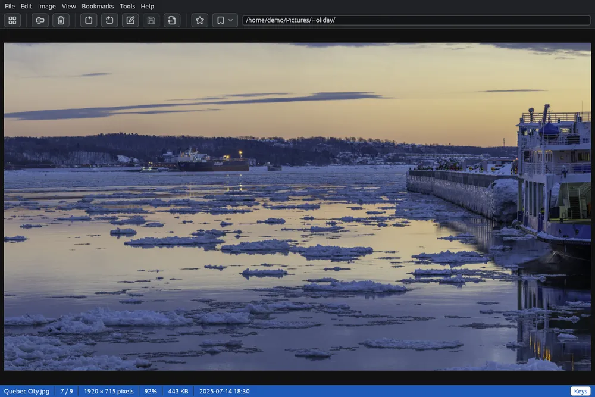

# Guardare le immagini

Il visore mostra una foto alla volta, grande quanto la finestra permette. Da lì passi alla foto successiva, ingrandisci, ruoti la foto e torni alla griglia.

## Aprire e chiudere il visore

- Fai doppio clic su una foto nella griglia, oppure selezionala e premi **Invio** (anche **Visualizza > Apri**).
- Per tornare alla griglia: **Esc**, un doppio clic sulla foto,  **Torna alla griglia** nella barra strumenti, oppure **Visualizza > Torna alla griglia**. Nella griglia resta selezionata la foto che stavi guardando.
- Anche la X della finestra torna alla griglia invece di chiudere EyeCanSee. Si può cambiare nelle [Opzioni](options.md).

Con più file selezionati, Invio apre il primo, e il visore si muove solo tra quelli.

## Passare da una foto all'altra

| Tasto | Cosa fa |
|---|---|
| →, Spazio, Pag↓ | Foto successiva |
| ←, Backspace, Pag↑ | Foto precedente |
| Inizio, Fine | Prima, ultima foto |

Le stesse voci sono nel menù **Visualizza** (Avanti, Indietro, Primo, Ultimo). Dopo l'ultima foto il visore si ferma; nelle [Opzioni](options.md) puoi farlo ricominciare dalla prima. Le foto vicine a quella mostrata vengono lette in anticipo, così si passa dall'una all'altra in fretta anche su un telefono o su un server.

## Ingrandire

- La **rotellina del mouse** ingrandisce e rimpicciolisce attorno al puntatore; **+** e **−** attorno al centro della finestra. Sul touchpad, avvicina o allontana due dita.
- **0** adatta di nuovo la foto alla finestra; **1** la mostra al 100%, un pixel della foto per ogni pixel dello schermo.
- Trascina una foto ingrandita per spostarla.

Una foto non si vede mai più piccola che adattata alla finestra, e una foto piccola si vede alla sua grandezza vera, senza ingrandirla. L'ingrandimento massimo (2000% all'inizio) si regola nelle [Opzioni](options.md), dove puoi anche far cambiare foto alla rotellina invece di ingrandire: allora **Ctrl** e la rotellina ingrandiscono comunque. La foto successiva parte di nuovo adattata.

## La barra di stato del visore

In fondo: il nome del file, la sua posizione nella cartella (per esempio 12 / 51), le dimensioni in pixel, l'ingrandimento, il peso su disco e la sua data: quella dello scatto se i metadati sono già stati letti nella griglia, altrimenti quella di modifica del file. Dopo una rotazione non ancora salvata dice anche **Modificata, non salvata**.

Il pulsante **Tasti** a destra elenca i tasti di ciò che stai guardando (una foto, un video, un modello 3D o un disegno CAD): finché il mouse ci sta sopra, o finché non ci fai clic di nuovo.

## La barra strumenti nel visore

La barra strumenti tiene solo ciò che lavora sulla foto mostrata:  **Rinomina…**,  **Elimina…**,  e  per ruotarla,  **Modifica immagine…**,  **Salva** e  **Salva come…**, poi i segnalibri e la barra degli indirizzi. Nuova cartella, taglia, copia, incolla e gli strumenti sono per la griglia; restano nei menù.

## Schermo intero

**F11** mostra la foto da sola, senza menù né barre, su fondo nero. **Esc** prima esce dallo schermo intero, poi torna alla griglia.

## Cos'altro puoi fare

- Ruotare e riflettere la foto: vedi [Ruotare e riflettere](rotate.md).
- Disegnarci sopra, ritagliarla, nasconderne delle parti: vedi [Modificare un'immagine](editor.md) (**Ctrl+E**).
- Salvarne una copia in un altro formato: vedi [Salva come](save-as.md) (**Ctrl+Maiusc+S**).
- **F2** rinomina la foto e **Canc** la elimina, come nella griglia; dopo l'eliminazione compare la foto successiva.
- Il clic destro sulla foto apre un menù con queste azioni e altre.
